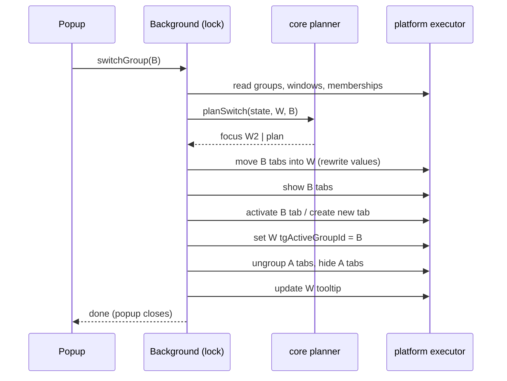

# Spec: Foundation and group core (Phase 1)

> Created: 2026-10-14

Delivers the working core of the extension: in-memory API fakes, global groups
with one group shown per window, hide/show group switching, new tabs joining the
window's group, reconciliation after restart, a minimal popup (list, switch,
create, rename, close), and the toolbar badge and tooltip. This spec carries no
lifecycle state — acceptance is the spec merged on the default branch with a
milestone and issues, and all progress lives in the GitHub issues and milestone.
A completed spec is moved to `docs/specs/archive/`.

## Outcome

- [ ] `test/fakes/` provides in-memory fakes of `tabs` (incl. `hidden`,
      `pinned`, `active`, `discarded`, `lastAccessed`, native `groupId`,
      `ungroup`, sharing state), `windows`, `sessions`, `storage` (`local` and
      `session`), `action`, `runtime` (messages, `onStartup`), `i18n` and a
      Web Locks stand-in, each with a `reset()`, plus `simulateRestart()` and
      `simulateDisableEnable()` (see Verification), and contract tests that
      encode the observed Firefox behaviour listed under Constraints (F1–F10).
- [ ] On first start every open normal window gets its own group that holds all
      of its non-pinned tabs; no tab is hidden by the first start.
- [ ] Every window shows exactly one group. Every visible non-pinned tab belongs
      to its window's active group, except tabs `tabs.hide` skipped (D8) — the
      **window invariant**; a group is active in at most one window.
- [ ] Switching a window to another group shows exactly that group's tabs and
      hides the previous group's tabs. Pinned tabs stay visible and ungrouped.
- [ ] Switching to a group that is active in another window focuses that window
      and changes nothing else. Switching to a group whose tabs are hidden in
      another window moves them into the current window as one contiguous block
      and shows them.
- [ ] Switching to an empty group opens one new tab (`about:newtab`) in it.
- [ ] A tab the user creates, or drags into a window, joins that window's active
      group.
- [ ] After a browser restart (and after disable/enable of the extension) every
      tab keeps its group membership and every window shows its previous active
      group: 0 lost assignments in the restart contract test.
- [ ] The popup lists all groups in stored order with title, tab count, a marker
      for the current window's active group and a marker for groups active in
      another window; the user can switch, create, rename, and close groups from
      it. Closing the last group leaves one new default group with one new tab.
- [ ] The toolbar badge shows the number of groups; the toolbar tooltip names the
      current window's active group.
- [ ] A group switch in a window with 200 tabs completes in under 500 ms.
- [ ] Every user-facing string exists in the `en` and `de` locales (keys listed
      in D25).
- [ ] `docs/architecture.md` flows 1 and 4 and the `test/fakes/` row match this
      spec (updated in the spec PR).

## Scope

### In scope

- Fakes and their contract tests (`test/fakes/`).
- Group model and persisted group list (`storage.local`, schema version 1).
- Tab → group membership and window → active group (`sessions` values).
- Group switch, empty-group switch, cross-window switch, focus-instead-of-switch.
- Window reconciliation on first install, browser start, extension enable, and
  for windows the user opens or restores.
- New, attached, and restored tabs.
- Operation serialisation with event deferral (Web Locks, D5).
- Minimal popup: group list, switch, create, rename, close (incl. last and empty
  group), with tokens in `src/shared/tokens.css`.
- Toolbar badge and tooltip.
- Manifest: `action` with the popup, permissions `storage`, `sessions`,
  `tabHide`, `incognito: "not_allowed"`.

### Out of scope

- Recording and restoring native tab groups across switches, the "first tab
  wins" rule, and the native-group feedback loop — Phase 2. Phase 1 only
  ungroups before hiding (see Prior decisions D13).
- Tab context menu and moving tabs between groups — Phase 3.
- Backup import / migration — Phase 4.
- Group detail with tab list, search, drag-and-drop order, keyboard shortcuts,
  marking of tabs that cannot be hidden — Phase 5.
- Full theme work and own backup format — Phase 6. Phase 1 uses the seed tokens
  from `docs/design.md` as they are.
- Options page.

## Constraints

- `docs/constitution.md` applies in full; in particular: no mutable module-level
  state (D5 serialises through Web Locks instead of a module variable),
  `src/core/` free of `browser`,
  `tabs.ungroup` before `tabs.hide` and `tabs.show` before `tabs.group`, tabs of
  a native group ungrouped before `tabs.remove`, no `innerHTML`, all strings via
  `browser.i18n`, 50-line functions, 400-line files.
- Component placement and boundaries follow `docs/architecture.md`: decisions in
  `src/core/`, API calls in `src/platform/`, listeners in `src/background/`,
  popup in `src/popup/` talking to the background only through typed messages
  in `src/shared/`.
- Observed Firefox behaviour the code and the fakes must respect (source: STG
  `docs/BEHAVIOR-*.md`, verified on Firefox 154; see Prior art):
  - F1: `tabs.hide` silently skips the active tab and tabs sharing camera,
    microphone, or screen, and resolves with the ids it did hide
    (TABGROUPS §9, §19). Hiding a hidden tab is a no-op (§24).
  - F2: Hidden tabs keep their state across restart and are restored hidden
    (TABGROUPS §6).
  - F3: A cross-window `tabs.move` reveals hidden tabs (MOVE §1); a hidden and
    discarded tab stays hidden (MOVE §3); a cross-window move of a discarded tab
    drops its `sessions` values, rewriting them right after the move works
    (MOVE §7).
  - F4: Detach/attach events arrive before the `tabs.move` promise resolves
    (MOVE §2); own actions' events can arrive after the API call resolves
    (DESIGN-EVENTS §1).
  - F5: Removing the last visible tab closes the window and its hidden tabs
    (REMOVE §1); a pinned tab keeps the window alive (REMOVE §2).
  - F6: `tabs.create` without `url` opens `about:newtab`; passing `about:newtab`
    explicitly is refused (CREATE §16). A create without index lands past a
    hidden tail (CREATE §15).
  - F7: Tab and window `sessions` values ride through `sessions.restore` and are
    readable in `tabs.onCreated` (CREATE §29); undo-close-window re-hides tabs via
    `onUpdated {hidden: true}` (TABGROUPS §18).
  - F8: No `runtime.onInstalled` on a plain restart or on enable
    (LIFECYCLE §1); windows already exist at background start (CREATE §55).
  - F9: Pinning strips native-group membership; `sessions` values survive pin
    and unpin (TABGROUPS §19, which also covers the microphone case of F1).
  - F10 (unverified, confirmed in QA): disabling an extension that hid tabs
    shows those tabs again; on enable they are visible with their `sessions`
    values intact (LIFECYCLE: disable → enable fires no event, storage and
    values survive).

## Prior art

- [Group switching and group state (Phase 1)](../prior-art.md#group-switching-and-group-state-phase-1)
  — global window model, focus-instead-of-switch, contiguous blocks, pinned tabs
  outside groups, activate-before-hide, sharing tabs.
- [Native Firefox tab groups interplay (Phase 2)](../prior-art.md#native-firefox-tab-groups-interplay-phase-2)
  — the STG behaviour docs are the source of F1–F9; ungroup-before-hide.
- [Testing with in-memory API fakes (Phase 1)](../prior-art.md#testing-with-in-memory-api-fakes-phase-1)
  — per-namespace fakes with `reset()`, behaviour facts as contract tests.
- [Build and release tooling (Phase 1)](../prior-art.md#build-and-release-tooling-phase-1)
  — `web-ext lint` in Verify.
- [Popup feature parity (Phase 5)](../prior-art.md#popup-feature-parity-phase-5)
  — PTG popup structure; Phase 1 builds its first level (group list).

Concrete source findings (read-only clone of STG `master` and PTG, 2026-10-14):
STG `groups.js` `applyNow` (focus if open elsewhere, `Tabs.moveToWindow` then
show, then hide), `tabs.js` `moveNative` (re-write `sessions` values after a
cross-window move), `windows.js` `initializeGroupsNow` (startup reconciliation),
`groups.js` `createId` (`crypto.randomUUID()`), manifest
`"incognito": "not_allowed"`; PTG `background.js` `setActionTitle` (badge =
group count, title = active group name) and the `GroupsFrame` popup actions.

## Human prerequisites

- none — Phase 1 needs no secrets, accounts, or external provisioning. AMO keys
  are needed only for signing (`docs/release.md`), which is not part of this
  milestone.

## Prior decisions

| Decision | Rationale | Date |
|---|---|---|
| D1 Persisted layout: `storage.local` holds `{ schemaVersion: 1, groups: [{ id, title }] }`; array order is the group order. Tab value `tgGroupId` (group id string) per tab; window value `tgActiveGroupId` per window; `storage.session` key `tgStarted` (D10). No other persisted state in Phase 1. | Constitution (group list in `storage.local`, membership in `sessions`); first persisted layout, so `SCHEMA_VERSION` stays 1 and no migration is needed. The `tg` prefix keeps the keys apart from the native `tab.groupId` and PTG's legacy `groupId`. | 2026-10-14 |
| D2 Group id = `crypto.randomUUID()`. | STG precedent (`createId`); no counter to serialise, ids stay unique across import later. Replaces assumption A6 (counter per window) of the grilling session. | 2026-10-14 |
| D3 Default title = i18n `defaultGroupTitle` ("Group $1" / "Gruppe $1") with the smallest positive integer whose title is not in use. `src/core/` receives a `formatTitle(n)` function as a parameter and never calls `i18n`. | Readable, stable, no UUID fragments; PTG's "N: Unnamed group" mixed id and name; core stays free of `browser`. | 2026-10-14 |
| D4 The window invariant: every visible non-pinned tab belongs to its window's active group, except tabs `tabs.hide` skipped (D8). All event handlers and reconciliation enforce it after re-reading state; handlers are idempotent instead of using skip flags. | Constitution (no module state, re-read on each event); makes late events of own actions (F4) harmless. | 2026-10-14 |
| D5 Serialisation: every state-changing operation, including event handlers, runs inside `navigator.locks.request("tab-groups-op", fn)`; an event that arrives while an operation runs waits for the lock and is evaluated against re-read state. The lock function is injected so tests use an in-memory fake. A rejected operation is caught and logged, releases the lock, and queues a D9 reconciliation of the affected window(s), so a half-applied switch is repaired at once. | Constitution: serialising queue without mutable module-level state — the lock queue lives in the browser, not in a module variable; Web Locks exist in Firefox ≥ 96 on secure `moz-extension:` pages. | 2026-10-14 |
| D6 Switch order in window W from group A to B: (1) if B is active in another window, focus it and stop; (2) move B's tabs hidden in other windows to the end of W as one block, re-write their `sessions` values (F3); (3) `tabs.show` B's tabs; (4) activate B's most recently accessed tab (`lastAccessed`), or create one new tab in W without `url` if B is empty (F6); (5) set W's `tgActiveGroupId` = B; (6) `tabs.ungroup` A's natively grouped tabs; (7) `tabs.hide` A's tabs; (8) update W's tooltip. `tabs.show`/`tabs.hide`/`tabs.move` are called once per switch with id arrays. `docs/architecture.md` flow 1 is updated to this order. | STG `applyNow` order; F1 (activate before hide); constitution (ungroup before hide, show before group); batched calls for the 200-tab target. | 2026-10-14 |
| D7 Pinned tabs carry no membership, are never hidden, and are ignored by every count and plan. A tab that gets pinned loses its `tgGroupId` value; a tab that gets unpinned joins its window's active group. | STG precedent (DESIGN-GROUPS §1); F9. | 2026-10-14 |
| D8 Tabs that `tabs.hide` skipped (sharing camera/microphone/screen) keep their membership and stay visible; the switch still completes. They are the only exception to D4. The next switch or reconciliation in that window tries to hide them again (D9 "hide, keep membership"). Marking them in the popup is Phase 5. | F1; avoids STG's auto-pinning, which changes the user's tab state. | 2026-10-14 |
| D9 Reconciliation of a window (runs for every normal window on start, and for a window from `windows.onCreated`): (a) resolve the active group — the stored `tgActiveGroupId` if the group exists and no other window keeps it (on a tie the focused window keeps it, else the one with the lowest window id), else a new default group — in that case (a window without a valid stored active group: a user-opened window, a tab torn off into a new window, or the loser of a tie) every visible non-pinned tab joins the new group, and (d) and (e) apply to hidden tabs only; (b) a tab (visible or hidden) without a valid membership joins the active group; (c) tabs of the active group are shown; (d) tabs of another group that is active in another window move there; (e) tabs of another group that is active nowhere are hidden and keep their membership — this also re-hides tabs Firefox showed while the extension was disabled (F10) and sharing tabs (D8). On first install with an empty group list, each window gets a new group that adopts its tabs via (b). | Enforces D4 with one routine; F2, F7, F10 make restored and re-shown tabs carry their values, so memberships survive restart and disable/enable (vision: 0 lost assignments); never leaves an orphaned tab invisible. A tie arises only from inconsistent stored state; giving the losing window's visible tabs a new group keeps them where the user sees them instead of moving them across windows. `docs/architecture.md` flow 4 is updated. | 2026-10-14 |
| D10 Start detection: the top level registers `runtime.onStartup` and `runtime.onInstalled` listeners and also runs the check once at top level; the check reads `storage.session` key `tgStarted` and, if it is absent, sets it and runs D9 for all normal windows inside the lock. | F8 — `onInstalled`/`onStartup` miss enable after disable; `storage.session` is cleared on restart, reload, and disable and is not module state; the `onStartup` listener makes Firefox wake the event page at launch. | 2026-10-14 |
| D11 Tab events: `tabs.onCreated`, `tabs.onAttached`, and `tabs.onUpdated` (filter `properties: ["pinned", "hidden"]`) re-check that one tab inside the lock: a hidden tab with a valid membership is left alone; a visible non-pinned tab without a valid membership, or with another group's membership, joins its window's active group (it is reassigned, never switched to). This covers new tabs, tabs dragged into another window, undo-close-tab, and a hidden tab the user shows from the all-tabs list. Tabs in non-`normal` windows are ignored. If the tab's window has no valid active group yet (e.g. `onAttached` of a torn-off tab before `windows.onCreated`), the handler runs D9 for that window instead. Window-wide repair stays D9's job. | STG `onAttached` precedent; D4. Restored windows keep their values (F7), so their visible tabs already match the restored active group. | 2026-10-14 |
| D12 A user-opened normal window gets a new default group via D9 that adopts its tabs. | Vision: every window shows exactly one group; STG's "window without group" mode contradicts it. | 2026-10-14 |
| D13 Phase 1 ungroups natively grouped tabs before hiding them without recording the native group; record and restore arrive in Phase 2. | Constitution rule (ungroup before hide) is binding; leaving native groups intact would leave dead headers (vision problem statement). Phase 1 is not released (first release after Phase 4, `docs/roadmap.md`). | 2026-10-14 |
| D14 Closing a group: if it is active in a window, that window first switches to the next group in list order that is not active elsewhere (the previous one for the last row); if none exists, to a new default group. Then the group's natively grouped tabs are ungrouped, its tabs removed with one `tabs.remove`, and the group deleted from the list. A group with tabs asks for an inline confirmation in the popup; an empty group closes without one. | Switching first keeps the window alive (F5); ungroup before remove (constitution, avoids saved groups); inline confirmation per `docs/design.md`; A5 of the grilling session. | 2026-10-14 |
| D15 Creating a group from the popup appends it with a D3 title and opens the inline rename field in its row; the current window does not switch. Enter or blur saves (D16); switching is a separate click. | Resolves the conflict with D20 (popup closes on switch) and avoids depending on the popup surviving tab activation. | 2026-10-14 |
| D16 Rename is inline: Enter or blur saves a trimmed non-empty title, Escape cancels; an empty title keeps the old one. | PTG precedent; no empty titles in the list. | 2026-10-14 |
| D17 Badge text = number of groups (global, `action.setBadgeText` without `windowId`); badge colour stays the Firefox default. Tooltip per window = i18n `actionTitle` ("Tab Groups — $1" with the active group title) via `action.setTitle({ windowId })`. | PTG `setActionTitle` precedent adapted to global groups; i18n instead of PTG's hard-coded string; a light/dark token pair cannot be passed to `setBadgeBackgroundColor`. | 2026-10-14 |
| D18 Private windows are not supported: `"incognito": "not_allowed"`. | STG precedent; tabs cannot move between private and normal windows, which breaks global groups. Replaces assumption A4 of the grilling session. | 2026-10-14 |
| D19 Permissions: `storage` (group list, start flag), `sessions` (membership, active group), `tabHide` (`tabs.hide`). No `tabs` permission: Phase 1 shows no tab titles or URLs. No host permissions. | Constitution: every new permission justified in its spec; least privilege. | 2026-10-14 |
| D20 Messages (types in `src/shared/messages.ts`): `getState`, `switchGroup { groupId }`, `createGroup` (response adds `createdGroupId` for the D15 inline rename), `renameGroup { groupId, title }`, `closeGroup { groupId }`, each with `windowId`. State = `{ groups: [{ id, title, tabCount, activeHere, activeElsewhere }] }`. The popup re-renders from each response. After `switchGroup` the popup closes. | Architecture boundary (popup only via `shared` messages); no live sync needed for a short-lived popup. | 2026-10-14 |
| D21 The popup reads its window id once with `windows.getCurrent()` (read-only) and sends it with every message. Each response is `{ ok: true, state }` or `{ ok: false, error }`; on `ok: false` the popup logs the error and re-renders from a fresh `getState`. Tab count = non-pinned tabs with that membership in all windows, hidden ones included. | Architecture allows read-only access; the background must know which window acts. | 2026-10-14 |
| D22 Badge text is refreshed after reconciliation, create, and close; tooltips after reconciliation, switch, rename, and close. | Only these operations change the shown values. | 2026-10-14 |
| D23 Build: `scripts/build.mjs` gains the entry `popup` (`src/popup/index.ts`) and copies `src/popup/popup.html` and `src/shared/tokens.css`; the manifest gets `action.default_popup` (`popup.html`) and `action.default_title` (`__MSG_extensionName__`). | Existing esbuild script stays the single build path (constitution tech stack). | 2026-10-14 |
| D24 Closing a window (or its last visible tab, F5) closes the hidden tabs of other groups stored in that window; Phase 1 accepts this. Groups stay in the list (possibly empty); reopening the window through Firefox "Recently closed windows" brings the tabs back with their membership, and D9 reconciles the restored window. Recovering the tabs automatically (STG `tryRestoreMissedTabs` approach) is a separate later roadmap phase, seeded via `/loopkit:roadmap` before Phase 4 (first release), because the roadmap north star promises no lost tab. | Resolved at the spec-acceptance gate by the maintainer: Phase 1 is not released; automatic recovery needs the closed tabs' URLs and memberships, which the event page cannot read after the close without a persisted snapshot — a design question of its own. | 2026-10-14 |
| D25 Locale keys (`en` and `de`): `extensionName`, `extensionDescription`, `defaultGroupTitle`, `actionTitle`, `popupTitle`, `newGroup`, `renameGroup` / `closeGroup` (button labels with `$1` = group title), `groupNameLabel`, `tabCountOne` / `tabCountOther` (`$1` tabs; `One` for n = 1, `Other` otherwise — correct for `en` and `de`), `activeElsewhere`, `closeGroupConfirm` (`$1` title, `$2` tab count text), `cancel`, `closeGroupAction`. | Constitution: every user-facing string via `browser.i18n`, both locales complete; `browser.i18n` has no plural rules. | 2026-10-14 |
## Design

- Switch sequence (D6):

- Popup prototype (design surface, consumed by the popup issue):
  [`docs/design/prototypes/group-core.html`](../design/prototypes/group-core.html)
  with screenshots
  [`docs/design/assets/group-core-light.png`](../design/assets/group-core-light.png)
  and [`docs/design/assets/group-core-dark.png`](../design/assets/group-core-dark.png).
  Frames: (1) group list — active marker, tab count, active-elsewhere icon,
  rename/close icon buttons on hover or focus, "New group" footer; (2) inline
  rename (D15, D16); (3) inline close confirmation (D14). The prototype's
  `:root` token block moves unchanged into `src/shared/tokens.css`; the
  `?scheme=` switch and the frame captions are prototype-only.

## Tracking

- Milestone: [Phase 1 — Foundation and group core](https://github.com/vaxul/firefox-add-on-tab-groups/milestone/1)
- Issues: created from this spec once it is merged (one per implementable step)

Each issue references this spec path in its body.

## Verification

- [ ] `npm run verify` passes, including the 80 % line coverage of `src/core/`.
- [ ] Fake contract tests cover F1–F9; F10 is modelled by `simulateDisableEnable()` and confirmed in QA.
- [ ] Unit tests of the core planners cover: switch with active tab in the
      outgoing group, switch to an empty group, switch to a group hidden in
      another window, switch to a group active elsewhere (focus only), sharing
      tab skipped by hide, pinned tabs, close of the active / an inactive / the
      last / an empty group, D3 default titles, D9 reconciliation cases (missing,
      unknown, duplicate active group; orphan visible and hidden tabs; tabs of a
      group active elsewhere).
- [ ] Integration tests in `test/integration/` against the fakes, importing
      the background entry after `vi.resetModules()` so the D10 top-level check
      runs per simulated start: first install with two windows; new tab and
      attached tab join the active group; a tab torn off into a new window
      gets a new group and stays in that window; `simulateRestart()` (new tab and
      window ids, `sessions` values and hidden state kept, `storage.session`
      cleared) loses 0 assignments; `simulateDisableEnable()` (all hidden tabs
      shown, values kept, `storage.session` cleared) loses 0 assignments and
      re-hides the inactive groups; an operation that throws mid-switch leaves
      the window reconciled (D5); one switch issues one `tabs.hide` and one
      `tabs.show` call.
- [ ] QA in Firefox (`npm start`): first start keeps all tabs visible in one
      group per window; create, rename, switch, and close groups from the popup;
      close the last group; switch to an empty group; switch to a group active in
      another window focuses it; restart Firefox and confirm every window shows
      its previous group with all tabs; disable the extension (confirm F10:
      hidden tabs appear) and enable it again (inactive groups hidden again,
      memberships kept); badge and tooltip match.
- [ ] QA in Firefox: a window with 200 tabs (two groups of 100) switches in
      under 500 ms (measured in the background console with
      `performance.now()` around the locked operation).
- [ ] QA in Firefox: the popup in light and dark mode and with `forced-colors`
      matches the design artifact; every action works by keyboard.

## Risks and mitigations

| Risk | Mitigation |
|---|---|
| Fakes diverge from Firefox behaviour | Contract tests encode F1–F10 from the STG behaviour docs; QA runs every flow in real Firefox. |
| Late events of own operations re-trigger work (F4) | D4/D11 idempotent re-checks against re-read state instead of skip flags. |
| Event page unloads during a long operation | Firefox keeps the page alive while listeners run and promises are pending; every operation is short and re-reads state, so a restart resumes via D10. |
| Native groups are lost on switch until Phase 2 | D13; Phase 1 is not released. |
| Hidden tabs lost when a window closes | D24: accepted for Phase 1, recoverable via Firefox "Recently closed windows"; automatic recovery in a later phase. |
| 200-tab switch exceeds 500 ms | Batched `tabs.*` calls (D6); `sessions` reads in parallel; QA measurement. |

## Decision log

- 2026-10-14: Prior-art clones of STG and PTG read for D2, D6, D9, D11, D14,
  D17, D18; findings recorded under Prior art.
- 2026-10-14: Spec-acceptance gate — window close (D24) resolved by the
  maintainer: accept in Phase 1, automatic recovery as a later roadmap phase.
- 2026-10-14: Spec review (REQUEST_CHANGES) addressed: D9 hides tabs of
  inactive groups instead of adopting them (disable/enable, F10); D8 is the
  only D4 exception; D15 no longer switches (conflict with D20); D5 uses Web
  Locks instead of a module-level promise chain (constitution); architecture
  flows 1 and 4 and the fakes row updated; keys prefixed `tg`; D25 locale keys.
- 2026-10-14: Spec re-review: D9 gives a window without a valid stored active
  group (user-opened, torn-off tab, lost tie) a new group that keeps its
  visible tabs; D11 defers to D9 for such a window; `createGroup` returns
  `createdGroupId`.
- 2026-10-14: Design review of the popup prototype — row actions use opacity
  instead of `visibility` so they stay keyboard- and screen-reader-reachable;
  tab counts carry visually hidden text; destructive text only on the
  `secondary` surface (dark destructive on `background` is 4.26:1).
- 2026-10-14: #3 implementation — the layout lives in `src/core/layout.ts`
  (types, `tg*` key constants, `parseLayout`), operations in
  `src/core/groups.ts`. `parseLayout` validates stored data: nothing stored
  yields an empty layout, malformed entries and duplicate ids are dropped,
  titles are trimmed; a `schemaVersion` newer than this build returns
  `undefined` so the caller does not overwrite data it cannot read. Rename and
  delete with an unknown id, and rename to a blank title, return the layout
  unchanged (same object).
- 2026-10-14: Fakes (#2) — one shared `World` backs `tabs`, `windows`, and
  `sessions`; `createFakeBrowser()` in `test/fakes/browser.ts` composes all
  namespaces, `install()` sets `globalThis.browser` and `navigator.locks`.
  Event timing (F4): `onDetached`/`onAttached` are delivered synchronously
  inside `tabs.move`; every other event is delivered in a later macrotask, and
  `flush()` waits for all deliveries and listener promises and rethrows
  listener errors. Seeding (`seedWindow`), `simulateRestart()`, and
  `simulateDisableEnable()` fire no events; a test emits `runtime.onStartup` /
  `onInstalled` itself (F8). Modelling choices not covered by F1–F10, to be
  checked in QA: `tabs.hide` also skips pinned tabs; a cross-window move drops
  the native `groupId`; a source window left without a visible tab after a
  move closes like F5; removing the active tab activates the adjacent visible
  tab (right, then left); activating a hidden tab shows it; after a restart
  non-active tabs come back discarded and sharing state is cleared; `i18n`
  reads the real `src/_locales` catalogues.
- 2026-10-14: #4 implementation — `planSwitch` (`src/core/switch.ts`) and
  `planClose` (`src/core/close.ts`) work on a `PlannerState` snapshot
  (`src/core/planner-state.ts`: layout, windows with raw `tgActiveGroupId`,
  tabs with raw `tgGroupId`, `pinned`, `hidden`, `index`, `lastAccessed`,
  `nativeGrouped`) and validate raw values against the layout themselves. A
  switch plan lists id arrays in D6 order; moved tabs get `tgGroupId`
  re-written by the executor. Only the target group's *hidden* tabs in other
  windows are moved (D6 literal); a visible leftover there (D8) stays for D9.
  The hide set is every visible non-pinned tab in the window with a valid
  membership other than the target — this re-tries tabs an earlier hide
  skipped (D8); tabs without a valid membership are never hidden (D9 adopts
  them). The most recent tab is chosen among the target's tabs that are in
  the window or moved there. Switching to the window's own active group or to
  an unknown group plans nothing. D14 target: the next free group after the
  closing one, else the nearest free one before it (covers the last row). The
  closing group is deleted before a fallback default group is created, so
  closing the last group "Group 1" yields a new "Group 1". The close switch is
  planned against the layout without the closing group, so it neither hides
  nor ungroups the closing tabs; the close plan ungroups and removes them
  afterwards.
- 2026-10-14: #5 implementation — the planners decide on a read-only
  `Snapshot` (`src/core/snapshot.ts`: layout, windows with raw stored
  `tgActiveGroupId`, tabs with raw `tgGroupId`, `hidden`, `pinned`, `active`,
  `lastAccessed`, native-group flag) built by the platform layer.
  `activeOwners` applies the D9 (a) tie-break across all normal windows;
  `planReconcile` (`src/core/reconcile.ts`) returns one plan per window
  (optional new group and layout, `assign`, `move` per target window, `show`,
  `activate`/`createTab`, `ungroup`, `hide`) with the executor order documented
  on the type. Additions beyond D9: if the window's active tab would be hidden
  or moved away, the plan activates the most recently accessed tab of the
  active group, or creates one if it has none (as D6 step 4; F1, F5); only
  visible tabs go into `hide`, and natively grouped ones also into `ungroup`
  (D13). `planTabRecheck` (`src/core/recheck.ts`) returns `none`, `assign`,
  `clear`, or `reconcile`; additions beyond D11: a hidden tab without a valid
  membership joins the active group and is shown (as D9 b, c), and a pinned
  tab that still carries `tgGroupId` gets it cleared (D7). A window that lost a
  duplicate active group counts as having no active group in D11.
- 2026-10-14: Platform adapters (#6) — `src/platform/group-store.ts` stores
  the D1 layout as the top-level `storage.local` keys `schemaVersion` and
  `groups` and loads it through `parseLayout` (a newer schema yields
  `undefined`); `claimStart()` reads and sets `tgStarted` in `storage.session`
  and returns `true` once per start (D10). `src/platform/tab-meta.ts` returns
  `sessions` values raw (non-strings as `undefined`; validation stays in core)
  and reads all values of all windows in parallel; `readPlannerState` builds
  the `PlannerState` of the switch/close planners (normal windows only),
  `readSnapshot` the D9/D11 `Snapshot` (all window types). The executor
  consumes the core plan types directly: `applySwitch` (`none` / `focus` /
  `switch`) and `applyClose` in `src/platform/executor.ts`, `applyReconcile`
  and `applyRecheck` in `src/platform/reconcile-executor.ts`. Each non-empty
  step is one call with an id array; moves go to the end of the target
  window (`index: -1`) and re-write `tgGroupId` afterwards (F3) — for a
  switch with the target group, for a reconcile move with each tab's
  membership read before the move, then the moved tabs are shown. A created
  tab gets its membership written directly. A plan with `createdGroup`
  persists its layout before the window's `tgActiveGroupId` is written.
  `applyReconcile` handles one window per call; the caller re-reads the
  snapshot before planning the next window. `applyRecheck` handles `assign`
  and `clear`; `reconcile` is left to the caller. Results report the ids
  `tabs.hide` did hide (D8). Tooltip and badge (D6 step 8, D17) stay with the
  background.
- 2026-10-14: #7 implementation — `src/background/operation.ts` holds the
  injected `LockFn` (`webLock` = `navigator.locks.request("tab-groups-op")`),
  an immutable `Context` (`lock`, `GroupDeps`), and `runOperation`: a failure
  is logged, the lock is released, and D9 runs for the affected windows in a
  new lock request before the error is rethrown. Event handlers
  (`src/background/events.ts`) name the tab's or new window's id as affected;
  popup requests name all normal windows, since a switch or close can touch
  tabs in any window. `reconcileWindows` applies one window's D9 plan and
  re-reads layout and snapshot before planning the next. Badge and tooltips
  are refreshed together for all normal windows after every reconciliation
  and every changing request (a superset of D22; one `windows.getAll` and one
  window value per window); a window without a valid active group gets its
  tooltip reset to the manifest default. The `action` adapter, the
  `windows.getAll` listing, and the browser-backed `GroupDeps`
  (`crypto.randomUUID`, i18n `defaultGroupTitle`) live in
  `src/platform/indicators.ts`. Messages (`src/shared/messages.ts`) are
  validated with `isRequest`; malformed ones get `{ ok: false, error:
  "Invalid message" }` without taking the lock, and messages from other
  senders than the extension are ignored. `getState` also runs inside the
  lock so it never reads a half-applied operation. The manifest gets an
  `action` with `default_title` only; `default_popup` follows with the popup
  (D23). A newer stored schema makes every operation fail with an error
  instead of overwriting the stored layout.
- 2026-10-14: #8 implementation — the popup lives in `src/popup/`:
  `popup.html` (structure, icon sprite and the prototype's component styles
  inline; tokens from `tokens.css`), `view.ts` (DOM via `createElement` /
  `textContent`), `controller.ts` (one request per action, re-render from
  each response, focus kept across re-renders), `index.ts` (entry). The
  popup's body replaces the prototype's `.popup` frame: Firefox draws the
  panel border and radius, so the body has width 300 px and no own border.
  `src/shared/i18n.ts` lists every locale key the code uses (`MessageKey`);
  a test checks that `en` and `de` define exactly these keys. Additions to
  D25: `activeElsewhere` takes `$1` = tab count text ("31 tabs, open in
  another window") so the punctuation stays in the locale; the list is
  labelled by the popup heading (`aria-labelledby`) instead of a separate
  "Groups" string. While an inline rename or confirmation is open, the other
  rows show no rename/close actions (prototype frames 2 and 3). Rename sends
  nothing for an empty or unchanged title (D16). The confirmation focuses
  Cancel; Escape cancels it. On a failed request the popup logs the error and
  re-renders from `getState` (D21); a failed switch keeps the popup open. No
  element is focused when the popup opens (the design shows no focus ring).
  Popup tests run in vitest's `happy-dom` environment (devDependency) against
  the real background and the fakes; the i18n fake resolves the catalogue by
  path, since a DOM environment replaces the global `URL`.
- 2026-10-14: #8 review — a blur of the rename field into another row
  re-renders only the renamed row, so the click that caused the blur (e.g. a
  switch right after "New group") is not lost; the other rows get their
  actions appended in place (keyboard users keep rename/close after Tab). A
  row patch falls back to a full render when the rows no longer match the
  groups (`data-group` per row). A blur elsewhere (Tab to "New
  group") leaves focus where the user moved it. A failed switch keeps focus
  on the clicked row. The active-elsewhere row carries no `title` (it would
  repeat the visually hidden text). Whether Escape in the rename field or
  the confirmation closes the Firefox popup is checked in QA.
